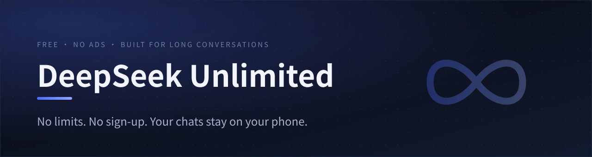
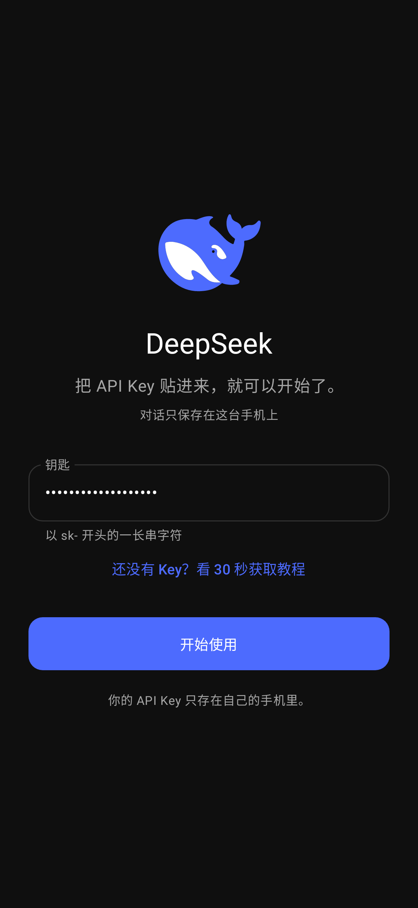
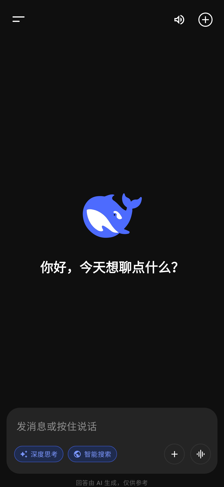
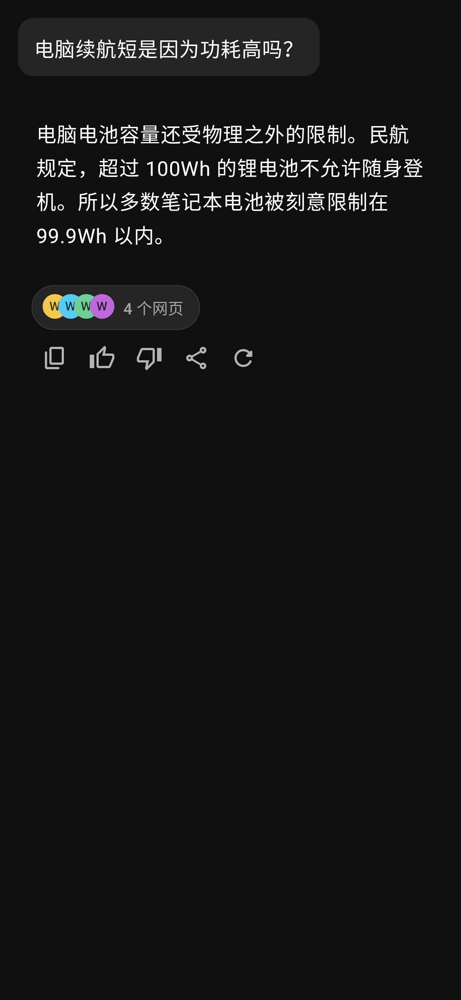

<div align="center">

<p align="center">
  <a href="README.md"><strong>English</strong></a> ·
  <a href="README.zh-CN.md">简体中文</a>
</p>



# DeepSeek Unlimited

**Chinese name: DeepSeek 无限制版**

**A third-party DeepSeek client that feels like the official app — with your own API key.**

No conversation quotas. Nothing new to learn. Pay for what you use. Multilingual prompts, 21 UI languages, no account system, and chats stay on your phone.

### [⬇ Download the latest APK (GitHub Releases)](../../releases/latest)

[Reproducible build](REPRODUCIBLE.md) · [Release notes](docs/RELEASE-0.11.3.md) · [Developer docs](DEVELOPING.md)






</div>

> **Unofficial client.** This project is not affiliated with, endorsed by, or authorized by DeepSeek. It looks like the official app so you don't have to relearn anything — not to impersonate the official product. The in-app “About & disclaimer” says this too.
>
> **Chats stay on your device.** No account, no server of ours; system backup and device-to-device transfer are disabled. To switch phones, export a ZIP and import it on the new device.

---

## 1. Language: use the language you think in

DeepSeek is multilingual, and this app does not restrict the language you type in. You can write in Chinese, English, Japanese, Korean, French, German, Spanish, Russian, Arabic, Hindi, Thai, Vietnamese, Turkish, Dutch, Polish, Ukrainian, Persian, Indonesian, Italian, Portuguese, and more. The model usually replies in the language you used; as with the official app, language is not a feature toggle.

You can also change the UI language:

- Where: **Settings → Language**
- Default: Follow system
- Available: English, 简体中文, 繁體中文, 日本語, 한국어, Français, Deutsch, Español, Português (Brasil), Русский, العربية, हिन्दी, Bahasa Indonesia, Italiano, ไทย, Tiếng Việt, Türkçe, Nederlands, Polski, Українська, فارسی

That is **21 UI languages**, plus “Follow system”. The UI re-renders in the new language; Arabic and Persian switch to a right-to-left layout. The language setting only affects the UI; it does not limit what you can chat about.

> These are two separate things: the UI can be Chinese while you chat in English; the UI can be English while you chat in Japanese. As with the official app, your prompt decides the chat language.

---

## 2. Download, verify, install

### 2.1 Download the latest build

The latest APK is published on **GitHub Releases**:

**→ [Download the latest APK](../../releases/latest)**

Release notes: [`docs/RELEASE-0.11.3.md`](docs/RELEASE-0.11.3.md).

The repository does not store APKs; the GitHub Release asset is the canonical download.

| Item | Current build |
| --- | --- |
| Version | `0.11.3` (versionCode 41) |
| Requirements | Android 12 or later (API 31+) |
| APK size | About 60 MB |
| SHA-256 | `0aaedd4e1ff4bf2e1347ae7fe82168abb768f850453afe2dd176420a16a7246d` |

Android only for now; there is no iOS or desktop build.

> New releases: always use the hash in the Releases page and the matching Release Notes. The version in this README may lag behind.
>
> Do not download from third-party file hosts, chat groups, or “crack” sites. If you got the APK somewhere else, verify it with 2.2 first.

### 2.2 Verify the APK really comes from this repository

This project does more than publish source: it makes “source → APK” reproducible. **The same source, the same pinned toolchain (Gradle 9.4.1, JDK 17, build-tools 37.0.0) and the same in-repo keystore produce a byte-identical APK.**

You do not have to trust us. There are three checks: A and B confirm file integrity and signing; C confirms the APK was built from this source. Everyone should do A; technical users should do C.

#### A. 30 seconds: check SHA-256

```bash
# Linux
sha256sum deepseek-unlimited-0.11.3.apk

# macOS
shasum -a 256 deepseek-unlimited-0.11.3.apk
```

```powershell
# Windows PowerShell
Get-FileHash .\deepseek-unlimited-0.11.3.apk -Algorithm SHA256
```

Expected:

```text
0aaedd4e1ff4bf2e1347ae7fe82168abb768f850453afe2dd176420a16a7246d
```

If it does not match, do not install.

#### B. 1 minute: check the signing certificate

If you have the Android SDK:

```bash
apksigner verify --print-certs deepseek-unlimited-0.11.3.apk
```

Expected certificate SHA-256:

```text
88e927c08e54abc623d15e7d8a3b455cb489f78271f4cc1f8fa97cd275b41d61
```

> Note: the project uses the Android debug keystore that is public in this repository, so sideloading is easy. A signature proves the APK was not repackaged, but **it cannot prove by itself that the APK came from this source** — anyone has the debug key. The real proof is C below.

#### C. 10 minutes: reproduce from source (strongest proof)

Install JDK 17, clone this repository, download the release APK, and run this from the repository root:

```bash
# Linux / macOS; on Windows, use WSL
# If JDK 17 is not in the default location, export JAVA_HOME=/path/to/jdk-17 first
./scripts/reproduce-release.sh /path/to/deepseek-unlimited-0.11.3.apk
```

The script:

1. validates **484** source, test, build-config and keystore files with `SOURCE-MANIFEST.sha256`;
2. runs `clean :app:assembleRelease` with Gradle 9.4.1 (offline through the local `vendor/` cache when present, otherwise through the Gradle wrapper) and the pinned dependencies;
3. performs a deterministic v2-only re-sign with `keystore/debug.keystore`;
4. compares the rebuilt APK byte-for-byte with the release APK you passed in;
5. verifies the signing certificate.

On success it ends with:

```text
OK: rebuilt APK is byte-identical to the published APK.
```

If the source was changed, the toolchain differs, or the release APK was replaced, this step fails. The script falls back to `dist/deepseek-unlimited-0.11.3.apk` if you omit the path.

See [REPRODUCIBLE.md](REPRODUCIBLE.md) for the full build description, toolchain versions and known limits.

> You can also build with `./gradlew assembleRelease`, but the signing block may differ, so byte-for-byte comparison is not guaranteed. Use the script above for that.
>
> The APK's code and resources are generated from this repository's source. No undisclosed private binary is bundled. If a local `vendor/` cache is present, the build uses it offline; otherwise the script falls back to `./gradlew` and your Android SDK. The maintainer's ~3 GB `vendor/` cache is intentionally not committed.

### 2.3 Install and first run

1. **Install the APK**  
   Open the downloaded APK on your phone, allow “install unknown apps” when prompted, and install. In-place upgrades normally keep your data. If Android reports a signature conflict, export your chats from the old version first, then uninstall and reinstall.

2. **Get an API key**  
   Open the [DeepSeek Open Platform](https://platform.deepseek.com/api_keys), sign up or log in, top up, create an API key, and save it. The key is usually shown only once; never share it.

3. **Paste the key and start chatting**  
   Open the app, paste the key, and save. No sign-up, no login, no phone number, no verification code.

You can also top up on the DeepSeek Open Platform. This app does not sell keys, does not offer top-ups, and takes no cut.

---

## 3. Why we built this

### 3.1 The official app is great, but it is first a consumer product

The official app is polished: dark UI, DeepThink, web search and file uploads all work well.

But it serves the ordinary usage of most people, so it has product-level boundaries: conversation quotas or message counts, retention limits for inactive chats, edit limits, input-length limits, suggestions to start a new chat when a conversation gets long, and so on. The exact rules change with official releases; what you see in your version is what applies.

Casual users may never notice. But people who treat AI as a long-term conversation partner, a writing partner or a research assistant keep hitting these boundaries: a “that's enough for today” message mid-conversation, a long chat gone after a few days away, a single sentence you want to fix but must start over for, a long document cut off.

These are not limits of the model's ability to talk. They are rules of a consumer product.

Many people are willing to pay for a better experience, but the official app has no “pay to remove these limits” button: the consumer product does not sell that.

### 3.2 The API is the pay-as-you-go path with no product quota

The DeepSeek Open Platform offers an API: billed by token, with no membership, no monthly plan, and no “you've talked enough today”. The balance is in your own account; you pay for what you use.

But for non-technical users this path is almost impossible: sign up on the platform, create a key, know the API URL and model name, understand tokens and context, and find a client that accepts a key. Most tutorials assume you write code.

So there is a gap: the path that suits heavy users best is reachable by very few.

### 3.3 We turned it into an app that requires no learning

We trimmed the open-source GPT Mobile project into a client that connects only to DeepSeek. The layout, dark theme, composer, search and thinking blocks stay close to the official app; on first launch it asks for exactly one thing: **an API key**.

No platform picker, model picker, account, login or verification code. You do not need to understand token, endpoint or model. Open it, paste the key, talk.

That is the whole point of the high-fidelity approach: not impersonation, but zero learning cost — it feels familiar the moment you switch from the official app.

It is also not a crack or a free ride: requests still go to DeepSeek, and the money still goes to DeepSeek.

### 3.4 How the money works

- **The app is free forever**: no ads, no membership, no in-app purchases, no cut.
- **The only cost is DeepSeek API usage**: billed at the official current price, deducted directly from your DeepSeek balance.
- **DeepThink, web search, long inputs, file parsing and history compaction** all consume tokens and are billed by the official rules.
- A few dollars can go a long way, but there is no “free unlimited”. If your balance runs out, the app says so honestly.

We do not sell keys, offer top-ups, or take a cut. Every cent you pay goes to DeepSeek.

> We are not building a “free DeepSeek”. We are wrapping the DeepSeek API into an app you would actually want to open every day.

---

## 4. Features and what makes it different

Here is the short version. The official app's exact limits change by release; this table describes the pain points this project addresses:

| What you may run into | What this app does |
| --- | --- |
| Message quota or limit reached | Use your own API key, pay as you go; the app imposes no message count |
| Chat too long, forced to start a new one | Compression + sliding window; the same chat keeps going |
| Want to fix one sentence, but hit an edit limit | Unlimited edits; regenerate after editing |
| Want to keep the original and try another phrasing | One-click Fork copies the whole history to a new chat |
| Moving away from the official app is painful | Import the official export ZIP; one-click export in the same format |
| 40,000-character input limit | No character cap in the composer |
| New phone or uninstall loses everything | Data is local, but you can export a ZIP anytime |

### 4.1 Move your chats: import official history, export with one click (the most important feature)

If we could keep only one feature, it would be this: **your chat history does not belong to any one app.**

**Import:** Settings → Local data → Import conversation ZIP.

Supports the official `deepseek_data-*.zip` (`export_format_version: 3`):

- parses `manifest.json` and `chat_sessions/*.json`;
- restores only the **current branch** via `current_message_id` + `parent_id`, so old replies from other branches do not leak in;
- restores user messages, thinking, answers, search sources, tool calls and file attachments;
- copies attachments into the app's private storage and relinks them;
- deduplicates by title + creation time; re-importing skips existing chats and never overwrites local ones.

**Export:** Settings → Local data → Export all conversations.

The generated ZIP matches the official export structure:

```text
manifest.json
user.json
chat_sessions/<uuid>.json
chat_sessions/<uuid>_files/...
```

Each message keeps `id`, `parent_id`, `role`, `status`, `thinking_enabled`, `search_enabled`, token usage, timestamps and `fragments`. Thinking is exported as `THINK`, answers as `RESPONSE`, sources as `TOOL_SEARCH`, and attachments as `FILE` + the actual files.

The export does not include the API key; `user.json` is a local placeholder with no account data.

This means:

- you can bring a long conversation over from the official app and continue it;
- you can export your local chats at any time, so this app does not lock them in;
- moving to a new phone, reinstalling, or archiving for the long term all have a path you can carry with you.

> The official ZIP format may change. v3 is supported today; if an import fails, open an issue with the ZIP's directory structure.

### 4.2 Long conversations do not break: compression + sliding window

To be clear: **we did not break DeepSeek's 1M-token context.**

“Unlimited” means the conversation can continue, not that the model can read infinite text at once. The full history stays on your device; only what is sent to the model for this turn is processed.

As the context fills up, the app:

1. asks the model to summarize older turns first (the compaction request itself also consumes tokens);
2. if summarization fails, or the summary still does not fit, switches to a **sliding window**: keeps only the newest turns that fit and stops sending older ones;
3. stores the compaction/window result as a checkpoint, so the next turn continues from there instead of reloading millions of tokens;
4. invalidates the checkpoint when you edit an older turn, so the next turn rebuilds from the edited content and an old summary cannot pollute it.

```text
Full local history (nothing deleted)
        │
        ├─ older turns ──→ summary / slide out of the window
        └─ recent turns ──→ kept as-is
                ↓
        sent to the model: ≤ 1M tokens
```

The trade-off is real: compaction itself costs some tokens, and very old details may survive only as a summary or fall outside the window. If you need exact recall, use export, search or ask again.

The test suite includes three parallel 1,000-turn histories, each estimated at ≥ 5 million tokens, to verify automatic sliding-window fallback, dropped old turns, and a window of ≤ 128k tokens.

So you do not have to start a new chat just because you have talked a lot.

### 4.3 Unlimited edits

- Both user messages and assistant answers can be edited; the app sets no edit-count limit.
- When you edit an assistant answer, the old version is kept as a revision you can switch back to; nothing is overwritten.
- When you edit a user message, later answers are regenerated from that turn; the old later content no longer participates in the new context.
- Editing itself is free; the tokens used to re-request the model are billed by the official rules.

Say it wrong, fix it. No need to weigh every sentence.

### 4.4 One-click Fork of a whole conversation

There is a Fork button in the top-right of the chat screen (disabled while generating). Tapping it copies the entire history into a new chat:

- user messages, assistant answers, thinking, search sources, attachments, revisions, tool events and model settings;
- new chat id, message ids and run ids, plus an updated chat timestamp;
- the title stays the same;
- the original chat is untouched.

Use it to “keep this version and try another approach”, or to branch inside a long conversation.

### 4.5 More room for topics

This app adds no topic whitelist, scenario restriction or product-level role gate. What you can discuss depends mainly on DeepSeek API content policy, model capability and your balance.

Compared with the consumer app, there is one less product-layer restriction; many normal but niche or long-tail topics are easier to continue here.

To be clear: this is not a bypass of official moderation. Illegal or policy-violating content may still be refused by DeepSeek, and accounts and keys are still subject to official risk controls. We do not promise “anything goes”.

### 4.6 Long inputs

The composer no longer has a 40,000-character product cap. Long documents, meeting notes, a whole chapter, or code snippets can be pasted directly.

The real boundary is the model's 1M-token context: if a single message is too large to fit, the app tells you clearly and keeps your draft; it does not silently truncate.

Longer inputs cost more tokens. That is pay-as-you-go, not an app restriction.

### 4.7 Web search, DeepThink and file uploads: unchanged

| Capability | Details |
| --- | --- |
| Web search | Uses DeepSeek's official server-side tools `deepseek_web_search` / `deepseek_read_url`; no second search key; search terms, sources and citations can be expanded |
| DeepThink | `reasoning_content` streams live; collapses automatically when the answer starts, and can be expanded again |
| File uploads | Images and file attachments work as before; importing an official ZIP brings attachments along |
| Basics | Streaming, stop, regenerate, copy, like/dislike are all retained |

These are DeepSeek API capabilities, not things we invented; we simply did not remove them.

Search, DeepThink, long inputs and file parsing all add token usage and are billed by DeepSeek's official rules.

---

## 5. What this project is

### 5.1 High-fidelity, but not official

We deliberately imitate the official app: layout, dark theme, composer, search and thinking blocks, message actions — so that switching from the official app requires almost no relearning. That is a product choice: it should feel seamless.

But imitating the experience is not impersonating the identity:

- The project is **DeepSeek Unlimited**; the Chinese name is **DeepSeek 无限制版**. The app label is **DeepSeek Unlimited** in English and as the fallback, and **DeepSeek 无限制版** in Simplified and Traditional Chinese. The icon says **unlimited**.
- Settings → About & disclaimer states clearly that this is not the official DeepSeek app and has no affiliation, partnership, authorization or endorsement from DeepSeek or Hangzhou DeepSeek Artificial Intelligence Basic Technology Research Co., Ltd.
- The version label says “unofficial client”.
- We do not claim to be official, and we do not fake official support, official top-up channels or official verification.

The “DeepSeek” name and trademark belong to their owner; this project uses the name only to describe the API service it connects to.

### 5.2 No third-party servers

This project runs no servers: no account backend, no cloud database, no analytics, no ads, no crash reporting.

**Apart from the requests you send to the official DeepSeek API, your conversation data is not uploaded to any third-party server.** We have no backend, analytics, ads or cloud sync. When you chat, messages go only to:

```text
https://api.deepseek.com
```

Web search and link reading are also handled by DeepSeek's servers; no other third party processes your conversation.

The APK is downloaded from GitHub, but GitHub only distributes the file; it has no access to your chat data.

### 5.3 No account system, data stays on this device

**This app has no account system.** No sign-up, login, phone number, verification code, password, password reset, member center or profile.

**This app has no backend of its own.** No account server, cloud database, sync service or analytics service. Chats, messages, settings and the API key are stored in the app's private storage on this device (Room + DataStore).

**Your data never goes to our servers — because there is no such server to take part.**

You still need a DeepSeek Open Platform account to create an API key and top up; that is DeepSeek's account, not an account with this app.

**This version disables Android system backup and device-to-device transfer.** Android will not automatically back up this app's chats, and will not migrate them to a new phone.

So:

- switching phones is manual: on the old phone, Settings → Local data → Export all conversations; on the new phone, install and use Settings → Local data → Import conversation ZIP;
- the exported ZIP contains no API key, so paste the key again on the new phone;
- uninstalling the app or clearing app data permanently deletes local chats; we have no cloud backup and cannot recover them.

### 5.4 No cracks, top-ups or shared keys

- We do not provide shared accounts, shared keys, top-ups, key sales, cracks or billing bypasses.
- API fees go directly to DeepSeek; this project takes no cut.
- We use only the public DeepSeek API; we do not scrape private endpoints from the official app or forge client credentials.
- If someone sells keys, top-ups or an “unlock fee” using this project's name, it is not us.

“Unlimited” means the app adds no product-level limits. It does not mean you do not pay.

### 5.5 Risks you should know

- Using a third-party client against the official API may, in theory, lead to account or key risk controls, rate limits or restrictions; judge for yourself.
- AI output can be wrong. Do not treat it as medical, legal or financial advice.
- A leaked API key lets someone else spend your balance. Do not share it, and do not post screenshots of it.
- DeepSeek's models, prices and API policies may change; this project cannot guarantee permanent availability or compatibility.
- “Unlimited” only means the app sets no message count, duration, edit count or retention limit. It does not mean the API is free, tokens are infinite, or official rules do not apply.

> In one sentence: **the app does not charge you and does not pay for you; it just makes it easier to pay DeepSeek.**

---

## 6. Technical details

| Item | Details |
| --- | --- |
| Project name | DeepSeek Unlimited (Chinese name: DeepSeek 无限制版) |
| Platform | Android 12+ (minSdk 31, targetSdk 37) |
| Language / UI | Kotlin + Jetpack Compose |
| Local storage | Room (chats) + DataStore (settings/key) |
| Network | Normal chat uses only the official DeepSeek API |
| Build | Gradle 9.4.1 + JDK 17 + Android SDK build-tools 37 |
| License | GNU GPL-3.0 |
| Upstream | [GPT Mobile](https://github.com/Taewan-P/gpt_mobile) |
| Current version | `0.11.3` (versionCode 41) |

This project is trimmed from GPT Mobile. The upstream uses GPL-3.0, so this project is released under **GPL-3.0** as well. You may view, modify and distribute the code under GPL-3.0; redistributed modified versions must keep the same license and source-availability terms.

More docs:

- [Development and build](DEVELOPING.md)
- [Reproducible build proof](REPRODUCIBLE.md)
- [Source manifest](SOURCE-MANIFEST.sha256)
- [Release history](docs/)
- [License](LICENSE)

Inside the app, “About → View GPL-3.0 license” and “Open source licenses” show the dependency licenses.

If the APK you reproduce with 2.2 differs from the published APK, open an issue with your SHA-256, build environment and script output.

---

<div align="center">

<sub>DeepSeek Unlimited (DeepSeek 无限制版) · free, open source, no ads, no in-app purchases. Not an official DeepSeek product. Based on GPT Mobile, GPL-3.0.</sub>

</div>
