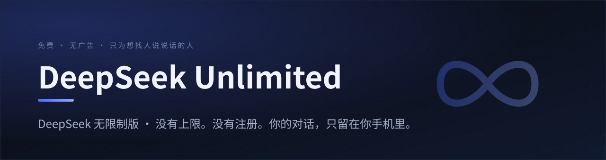
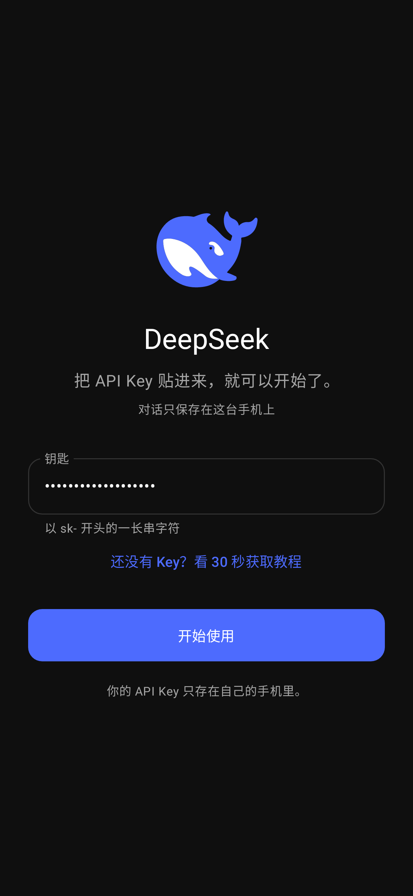
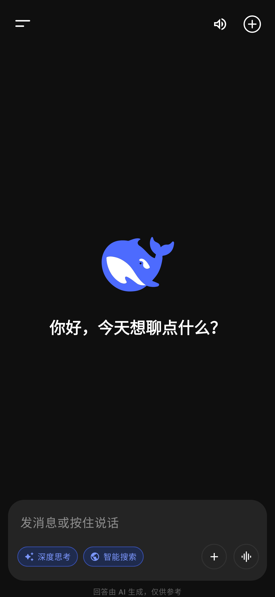
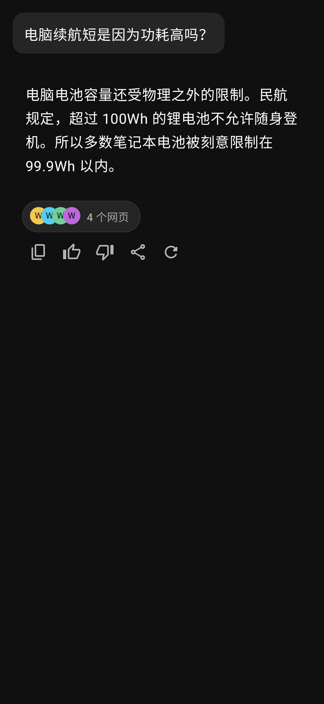

<div align="center">

<p align="center">
  <a href="README.md">English</a> ·
  <a href="README.zh-CN.md"><strong>简体中文</strong></a>
</p>



# DeepSeek Unlimited

**中文名：DeepSeek 无限制版**（本文档统一用 **DeepSeek Unlimited** 指代项目）

**一个高仿官方体验、但用你自己 DeepSeek API Key 的第三方客户端。**

没有对话额度，不用重新学怎么用。用多少，付多少。支持多语言提问与 21 种界面语言，没有账号系统，对话只存本机。

### [⬇ 下载最新版 APK（GitHub Releases）](../../releases/latest)

[可复现构建](REPRODUCIBLE.md) · [版本说明](docs/RELEASE-0.11.3.md) · [开发文档](DEVELOPING.md)






</div>

> **非官方客户端。** 本项目与 DeepSeek 官方没有隶属、合作、授权或背书关系。界面像官方，是为了让你不用重新学习；不是为了冒充官方。App 内「关于与免责声明」也明确写了这一点。
>
> **对话数据只存储在本机。** 没有账号，没有我们的服务器；系统备份和换机迁移已关闭。换机请手动导出对话 ZIP，再在新设备导入。

---

## 一、语言：和官方一样，用你习惯的语言

DeepSeek 模型本身是多语言的，这个 App 不会限制你用什么语言提问。中文、English、日本語、한국어、Français、Deutsch、Español、Русский、العربية、हिन्दी、ไทย、Tiếng Việt、Türkçe、Nederlands、Polski、Українська、فارسی、Bahasa Indonesia、Italiano、Português 都可以直接说。模型通常会按你的提问语言回答；和官方 App 一样，语言不是功能开关。

界面也可以改成你习惯的语言：

- 入口：**设置 → 语言**
- 默认：跟随系统
- 可选：English、简体中文、繁體中文、日本語、한국어、Français、Deutsch、Español、Português (Brasil)、Русский、العربية、हिन्दी、Bahasa Indonesia、Italiano、ไทย、Tiếng Việt、Türkçe、Nederlands、Polski、Українська、فارسی

共 **21 种界面语言**，外加「跟随系统」。切换后界面会按新语言重新渲染；阿拉伯语、波斯语会自动切换为从右到左的布局。语言设置只影响界面，不会限制聊天内容。

> 这两件事是分开的：界面可以是中文，聊天可以用 English；界面可以是 English，聊天可以用日本語。和官方 App 一样，聊天语言由你的提问决定。

---

## 二、下载、验证与安装

### 2.1 下载最新版

最新版 APK 发布在 **GitHub Releases**：

**→ [下载最新版 APK](../../releases/latest)**

版本说明：[`docs/RELEASE-0.11.3.md`](docs/RELEASE-0.11.3.md)。

仓库不存放 APK；安装包只在 GitHub Releases 发布。

| 项目 | 当前版本 |
| --- | --- |
| 版本 | `0.11.3`（versionCode 41） |
| 系统要求 | Android 12 及以上（API 31+） |
| 安装包大小 | 约 60 MB |
| SHA-256 | `0aaedd4e1ff4bf2e1347ae7fe82168abb768f850453afe2dd176420a16a7246d` |

目前只提供 Android APK，没有 iOS 或桌面版。

> 新版本发布后，以 Releases 页面和对应 Release Notes 里的哈希为准；README 里的版本号可能滞后。
>
> 请不要从第三方网盘、群文件或“破解站”下载。如果你已经从别处拿到了 APK，请先按 2.2 校验。

### 2.2 验证 APK 确实由本仓库源码构建

这个项目不仅公开源码，还把“源码 → APK”做成了可复现的：**同一份源码、同一套固定版本工具链（Gradle 9.4.1、JDK 17、build-tools 37.0.0）和同一个仓库内 keystore，可以构建出与发布包字节级完全相同的 APK。**

你不需要无条件相信我们。下面三层验证：A、B 用来确认文件完整性和签名，C 用来确认它确实由这份源码构建。普通用户至少做 A；技术用户建议做 C。

#### A. 30 秒：核对 SHA-256

```bash
# Linux
sha256sum deepseek-unlimited-0.11.3.apk

# macOS
shasum -a 256 deepseek-unlimited-0.11.3.apk
```

```powershell
# Windows PowerShell
Get-FileHash .\deepseek-unlimited-0.11.3.apk -Algorithm SHA256
```

输出应为：

```text
0aaedd4e1ff4bf2e1347ae7fe82168abb768f850453afe2dd176420a16a7246d
```

不一致就不要安装。

#### B. 1 分钟：核对签名证书

如果你装了 Android SDK：

```bash
apksigner verify --print-certs deepseek-unlimited-0.11.3.apk
```

证书 SHA-256 应为：

```text
88e927c08e54abc623d15e7d8a3b455cb489f78271f4cc1f8fa97cd275b41d61
```

> 说明：本项目为了方便侧载，使用的是仓库里公开的 Android debug keystore。签名能证明 APK 没有被二次打包，但**不能单独证明它来自这份源码**——因为任何人都拿得到这个 debug key。真正的来源证明是下面的 C。

#### C. 10 分钟：从源码完整复现（最强证明）

先安装 JDK 17，克隆本仓库，从 Releases 下载 APK，然后在仓库根目录执行：

```bash
# Linux / macOS；Windows 建议用 WSL
# 如果 JDK 17 不在默认位置，先 export JAVA_HOME=/path/to/jdk-17
./scripts/reproduce-release.sh /path/to/deepseek-unlimited-0.11.3.apk
```

脚本会依次做这些事：

1. 用 `SOURCE-MANIFEST.sha256` 校验 **484 个**源码、测试、构建配置和 keystore 文件；
2. 用 Gradle 9.4.1（本地有 `vendor/` 缓存时离线构建，否则走 Gradle wrapper）和固定版本依赖执行 `clean :app:assembleRelease`；
3. 用 `keystore/debug.keystore` 做确定性的 v2-only 重签；
4. 把重建的 APK 与你传入的发布 APK 做逐字节 `cmp`；
5. 验证签名证书。

成功时最后会输出：

```text
OK: rebuilt APK is byte-identical to the published APK.
```

如果源码被改动、工具链版本不同，或者发布包被替换，这一步就会失败。省略路径时，脚本默认使用 `dist/deepseek-unlimited-0.11.3.apk`；如果要用这个默认值，请把下载的 APK 放到那里。

完整的构建说明、工具链版本和已知限制见 [REPRODUCIBLE.md](REPRODUCIBLE.md)。

> 直接运行 `./gradlew assembleRelease` 也能从源码构建，但签名块可能不同，不能保证逐字节一致；要和发布包对比，请使用上面的脚本。
>
> APK 的代码和资源由本仓库源码生成，没有把未公开的私有二进制打进包。如果本机存在 `vendor/` 缓存，构建会离线使用它；仓库不提交这个约 3 GB 的目录，没有缓存时脚本会回退到 `./gradlew` 和本机 Android SDK。

### 2.3 安装与第一次使用

1. **安装 APK**  
   在手机上点开下载好的 APK，按系统提示允许“安装未知应用”，然后安装。覆盖升级一般会保留数据；如果提示签名冲突，请先在旧版里导出对话，再卸载重装。

2. **准备 API Key**  
   打开 [DeepSeek 开放平台](https://platform.deepseek.com/api_keys)，注册/登录，充值，创建一个 API Key，复制并保存好。Key 通常只显示一次，不要发给任何人。

3. **粘贴 Key，开始聊天**  
   打开 App，把 Key 贴进去，保存。没有注册、没有登录、没有手机号、没有验证码。

充值入口也在 DeepSeek 开放平台。本 App 不卖 Key、不代充、不抽成。

---

## 三、我们为什么做这个

### 3.1 官方 App 很好用，但它首先是一个“消费端产品”

官方 App 的完成度很高：深色界面、深度思考、联网搜索、文件上传，都做得很顺手。

但它要服务大多数人的普通用量，所以会有产品层的边界：对话额度或次数、长期不活跃对话的保留期限、修改次数、单次输入长度、对话过长时建议新开，等等。具体规则会随官方版本变化，以你实际看到的为准。

偶尔问问的人感觉不到这些边界。但对把 AI 当长期对话对象、写作搭档、研究助手的人来说，这些边界会不断打断你：聊到一半被提示“今天差不多了”，隔几天回来发现对话不见了，想改一句话却要重新开一段，输入长文被截断。

这些限制不是模型不会聊，而是消费端产品的规则。

很多人愿意为更好的体验付钱，但在官方 App 里找不到“付费解除这些限制”的入口：消费端产品并不卖这个。

### 3.2 API 才是“按量付费、没有产品额度”的那条路

DeepSeek 开放平台提供 API：按 token 计费，没有会员、没有包月、没有“今天聊够了”。余额在你自己账户里，用多少扣多少。

但对不懂技术的人，这条路几乎走不通：要注册开放平台、创建 Key、知道 API 地址和模型名、理解 token 和上下文，还要找到一个能填 Key 的客户端。大多数教程默认你会写代码。

于是出现一个落差：明明有一条更适合重度用户的路，却只有少数人走得到。

### 3.3 我们把它做成了一个不需要学习的 App

我们基于开源项目 GPT Mobile 裁剪出一个只连接 DeepSeek 的客户端。界面、深色主题、输入框、搜索/思考块尽量贴近官方；首次启动只问一件事：**API Key**。

没有平台选择、模型选择、账号、登录、验证码。你不需要理解 token、endpoint、model 这些词。打开、贴 Key、说话。

这就是“高仿”的全部意义：不是冒充，而是把学习成本降到零，让你从官方 App 过来时几乎无感——润物细无声。

也不是破解或白嫖：请求仍然发给 DeepSeek，钱仍然付给 DeepSeek。

### 3.4 钱到底怎么算

- **App 永久免费**：没有广告、没有会员、没有内购、没有抽成。
- **唯一费用是 DeepSeek API 的用量费**：按官方当期价格，从你的 DeepSeek 余额里直接扣。
- **深度思考、联网搜索、长输入、文件解析、历史压缩**都会消耗 token，按官方规则计费。
- 几块钱可以聊很久，但不存在“免费无限”。余额不足时，App 会如实报错。

我们不卖 Key、不代充、不抽成。你付的每一分钱都进 DeepSeek 的账户。

> 我们做的不是“免费版 DeepSeek”，而是“把 DeepSeek API 包装成一个你愿意每天打开的 App”。

---

## 四、功能与不同之处

先看一张表。官方 App 的具体限制会随版本变化，下表描述的是本项目要解决的痛点：

| 你可能遇到的限制 | 本 App 的做法 |
| --- | --- |
| 对话次数或额度用完 | 用你自己的 API Key，按量付费，App 不设对话次数 |
| 对话太长，被迫开新对话 | 压缩 + 滑动窗口，同一个对话可以一直续 |
| 想改一句话，却受修改次数限制 | 不限次数修改，改完重新生成 |
| 想保留原对话，再试另一种问法 | 一键 Fork，整段历史复制到新对话 |
| 从官方 App 搬家很麻烦 | 直接导入官方导出 ZIP；一键导出同格式 ZIP |
| 输入 4 万字就被截断 | 输入框不设字数上限 |
| 换手机或卸载就全没了 | 数据本地，但可以一键导出 ZIP |

### 4.1 对话搬家：导入官方历史，一键导出（最重要）

如果只能保留一个功能，我们会保留这个：**你的对话历史不属于任何一个 App。**

**导入：** 设置 → 本机数据 → 导入对话 ZIP。

支持官方导出的 `deepseek_data-*.zip`（`export_format_version: 3`）：

- 解析 `manifest.json` 和 `chat_sessions/*.json`；
- 按 `current_message_id` + `parent_id` 只恢复**当前分支**，不会把分叉里的旧回复混进来；
- 还原用户消息、思考、回答、搜索来源、工具调用、文件附件；
- 附件复制到 App 私有目录并重新关联；
- 按「标题 + 创建时间」去重，重复导入跳过，不覆盖本机已有对话。

**导出：** 设置 → 本机数据 → 导出所有对话。

生成的 ZIP 与官方导出结构一致：

```text
manifest.json
user.json
chat_sessions/<uuid>.json
chat_sessions/<uuid>_files/...
```

每条消息保留 `id`、`parent_id`、`role`、`status`、`thinking_enabled`、`search_enabled`、token 用量、时间和 `fragments`。思考导出为 `THINK`，回答导出为 `RESPONSE`，来源导出为 `TOOL_SEARCH`，附件导出为 `FILE` + 实际文件。

导出不包含 API Key；`user.json` 是本地占位，不含账号信息。

这意味着：

- 你可以把官方 App 里聊了很久的对话搬过来，接着聊；
- 也可以随时把本机对话导出归档，不被这个 App 锁死；
- 换手机、重装、长期保存，都有一条可带走的路。

> 官方 ZIP 的格式可能随官方版本变化。当前支持 v3；如果导入失败，请附上 ZIP 的目录结构开 issue。

### 4.2 长对话不中断：压缩 + 滑动窗口

先澄清：**我们没有突破 DeepSeek 的 1M token 上下文。**

“无限制”指的是对话可以一直继续，不是模型一次能读无限内容。完整历史在本机一条不少；只有“这一次发给模型的内容”会被处理。

接近上下文上限时，App 会：

1. 先把较早的轮次交给模型做摘要压缩（压缩请求本身也会消耗 token）；
2. 如果摘要调用失败，或者压缩后还是放不下，自动切到**滑动窗口**：只保留最近能放下的若干轮，更早的轮次不再发给模型；
3. 把压缩/窗口结果存成 checkpoint，下一轮从这里继续，不用每轮重新加载几百万 token；
4. 如果你编辑了旧轮次，旧 checkpoint 会自动失效，下一轮重新生成，避免旧摘要污染新内容。

```text
本机完整历史（一条不少）
        │
        ├─ 较早轮次 ──→ 摘要 / 滑出窗口
        └─ 最近轮次 ──→ 原样保留
                ↓
        发给模型：≤ 1M token
```

代价也要说清楚：压缩本身会花一点 token；非常久远的细节可能只剩摘要，甚至不在窗口里。需要精确回忆时，用导出、搜索或重新提问。

项目里有 3 路并行、每路 1000 轮、历史估算 ≥ 500 万 token 的压测用例，验证自动切滑动窗口、旧轮次被丢弃、窗口不超过 128k token。

所以，你不必因为“聊得太多”而被迫开一个新对话。

### 4.3 修改不限次数

- 用户消息和助手回答都能改，App 不设修改次数上限。
- 改助手回答时，旧版本会作为修订保留，可以前后切换，不会覆盖。
- 改用户消息时，会从该轮重新生成后续回答；原来的后续内容不再参与新上下文。
- 修改本身不收费；重新请求模型产生的 token 按官方计费。

说错了就改，不用一句话斟酌半天。

### 4.4 一键 Fork 整段对话

对话页右上角有 Fork 按钮（生成中禁用）。点击后，当前对话的全部历史会复制到一个新对话：

- 用户消息、助手回答、思考、搜索来源、附件、修订、工具事件、模型设置；
- 只换新的 chat id、message id、run id，并更新对话时间；
- 标题保持一致；
- 原对话完全不动。

适合“保留这个版本，再试另一种聊法”，也适合在长对话里做分支实验。

### 4.5 能聊的话题更多

本 App 不额外设置话题白名单、场景限制或产品层的角色门槛。你能聊什么，主要取决于 DeepSeek API 的内容政策、模型能力和你的余额。

相比消费端 App，少了一层产品侧的场景限制；很多正常但偏小众、偏长尾的话题，在这里更容易继续。

需要说明：这不是绕过官方审核。违法、违规内容仍可能被 DeepSeek 拒绝，账号和 Key 仍受官方风控约束。我们不承诺“什么都能聊”。

### 4.6 支持超长输入

输入框不再有 4 万字的产品层上限。长文、会议纪要、整章小说、代码片段，可以直接粘贴。

真正的边界是模型的 1M token 上下文：如果单条消息大到装不下，App 会明确提示，并保留你的草稿，不会悄悄截断。

输入越长，token 费用越高。这是按量计费，不是 App 在限制你。

### 4.7 联网搜索、深度思考、文件上传：保持原样

| 能力 | 说明 |
| --- | --- |
| 联网搜索 | 使用 DeepSeek 官方服务端工具 `deepseek_web_search` / `deepseek_read_url`，不需要第二个搜索 Key；搜索词、来源、引用可以展开 |
| 深度思考 | `reasoning_content` 实时滚动；正文开始后自动折叠，可展开回看 |
| 文件上传 | 图片和文件附件照常发送；导入官方 ZIP 时附件一起迁移 |
| 基础操作 | 流式输出、停止生成、重新生成、复制、点赞/点踩都保留 |

这些能力不是我们发明的，是 DeepSeek API 原本就有的；我们做的是不把它们阉割掉。

搜索、深度思考、长输入、文件解析都会增加 token 消耗，按 DeepSeek 官方规则计费。

---

## 五、这个项目的性质

### 5.1 高仿，但不是官方

我们确实在刻意模仿官方：布局、深色主题、输入框、搜索/思考块、消息操作，尽量做到你从官方 App 过来不用重新学。这是“润物细无声”的产品选择。

但模仿体验不等于冒充身份：

- 项目名称是「DeepSeek Unlimited」，中文名是「DeepSeek 无限制版」；App 名称在英文/兜底显示「DeepSeek Unlimited」，简体中文和繁體中文显示「DeepSeek 无限制版」；图标上写着「unlimited」；
- 设置 → 关于与免责声明里明确写着：这不是 DeepSeek 官方 App，与杭州深度求索人工智能基础技术研究有限公司及 DeepSeek 官方没有隶属、合作、授权或背书关系；
- 版本号旁标注「非官方客户端」；
- 我们不会自称官方，不会伪造官方客服、官方充值入口或官方认证。

“DeepSeek”名称和商标归其权利人所有，本项目仅用于说明所连接的 API 服务。

### 5.2 没有第三方服务器

本项目不运营任何服务器：没有账号后端、没有云数据库、没有统计、没有广告、没有崩溃上报。

**除了你主动发给 DeepSeek 官方 API 的请求，你的对话数据不会被上传到任何第三方服务器。** 我们没有自己的后端，也没有统计、广告或云同步；聊天时，消息只发往：

```text
https://api.deepseek.com
```

联网搜索、读链接也由 DeepSeek 服务端完成；除此之外，没有第三方参与处理你的对话。

下载 APK 走 GitHub，但 GitHub 只分发文件，不接触你的对话数据。

### 5.3 没有账号系统，数据只在本机

**本 App 没有账号系统。** 没有注册、登录、手机号、验证码、密码、找回密码、会员中心、个人资料。

**本 App 也没有自己的后端。** 没有账号服务器、云数据库、同步服务、统计服务。对话、消息、设置和 API Key 都存储在本机的应用私有存储里（Room + DataStore）。

**数据不会到我们的服务器——因为根本没有这样的服务器需要参与。**

你仍然需要一个 DeepSeek 开放平台账号来创建 API Key 和充值；但那是 DeepSeek 的账号，不是本 App 的账号。

**本版本已关闭 Android 系统备份和换机迁移。** 系统不会自动备份本 App 的对话，也不会在换机时自动搬迁数据。

因此：

- 换机必须手动：旧设备「设置 → 本机数据 → 导出所有对话」，新设备安装后「设置 → 本机数据 → 导入对话 ZIP」；
- 导出的 ZIP 不含 API Key，新设备需要重新粘贴 Key；
- 卸载 App、清除应用数据会永久删除本机对话；我们没有云端备份，也无法替你恢复。

### 5.4 不碰破解、代充、共享 Key

- 不提供共享账号、共享 Key、代充、卖 Key、破解或绕过计费；
- API 费用直接付给 DeepSeek，本项目不抽成；
- 只用公开的 DeepSeek API，不抓取官方 App 私有接口，不伪造客户端凭证；
- 如果你看到有人拿这个项目卖 Key、代充或收“解锁费”，那不是我们。

“无限制”是 App 不设产品层限制，不是不付钱。

### 5.5 你需要知道的风险

- 使用第三方客户端连接官方 API，理论上存在账号或 Key 被风控、限流、限制的风险；请自行判断。
- AI 生成的内容可能出错，不要把它当作医疗、法律或财务建议。
- API Key 泄露意味着别人可以花你账户里的钱。不要发给任何人，也不要截图分享。
- DeepSeek 的模型、价格和 API 政策可能变化，本项目不保证永远可用或永远兼容。
- “无限制”只表示 App 不设次数、时长、修改次数或对话保留期限；不表示 API 免费、token 无限，或不受官方规则约束。

> 一句话：**App 不收你的钱，也不替你付钱；它只是让你更方便地把钱付给 DeepSeek。**

---

## 六、技术信息

| 项目 | 说明 |
| --- | --- |
| 项目名 | DeepSeek Unlimited（中文名：DeepSeek 无限制版） |
| 平台 | Android 12+（minSdk 31，targetSdk 37） |
| 语言 / UI | Kotlin + Jetpack Compose |
| 本地存储 | Room（对话）+ DataStore（设置/Key） |
| 网络 | 正常聊天仅 DeepSeek 官方 API |
| 构建 | Gradle 9.4.1 + JDK 17 + Android SDK build-tools 37 |
| 许可证 | GNU GPL-3.0 |
| 上游 | [GPT Mobile](https://github.com/Taewan-P/gpt_mobile) |
| 当前版本 | `0.11.3`（versionCode 41） |

本项目基于 GPT Mobile 裁剪，上游使用 GPL-3.0，因此本项目也以 **GPL-3.0** 发布。你可以在 GPL-3.0 的范围内查看、修改和分发代码；分发修改版时，需要保留同样的许可与源代码获取方式。

更多文档：

- [开发与构建](DEVELOPING.md)
- [可复现构建证明](REPRODUCIBLE.md)
- [源码清单](SOURCE-MANIFEST.sha256)
- [版本变更](docs/)
- [许可证](LICENSE)

App 内「关于 → 查看 GPL-3.0 许可证」和「开源许可」可以查看依赖的许可证。

如果你按 2.2 复现出的 APK 与发布包不一致，请开 issue，附上你的 SHA-256、构建环境和脚本输出。

---

<div align="center">

<sub>DeepSeek Unlimited（DeepSeek 无限制版）· 免费、开源、无广告、无内购。不是 DeepSeek 官方产品。基于 GPT Mobile 修改，GPL-3.0。</sub>

</div>
